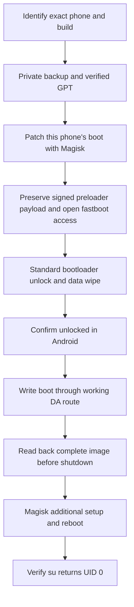

# realme 8 5G root guide

[](https://github.com/0xsheet/realme-8-5g-root-guide/actions/workflows/checks.yml)

[العربية](README.ar.md) · [Full procedure](docs/guide.en.md) · [دليل التنفيذ بالعربي](docs/guide.ar.md)

A documented successful root of **realme RMX3241 / RE513CL1, Android 13,
RMX3241_11_F.12, LATAM**, using **Magisk 30.7**. Includes source-pinned tool
downloads, USB rules, device-bound backup sessions, same-phone boot patching,
explicit flash plans, GPT validation, readback verification, and troubleshooting.

**Hardware evidence:** the original procedure completed Android boot after Magisk setup
and reboot, with `su -c id` returning `uid=0(root)` on 2026-10-26.
**Software evidence:** the reusable helpers have automated/offline checks; the new helpers
have not been replayed end-to-end on another phone. That distinction matters.

This is a narrowly scoped case study, **not a universal one-click root application**.
The included write workflow refuses different models, builds, Android versions, or regions.
For another device, start with [the adaptation guide](docs/other-devices.md).

## Start here

1. Read [requirements and full instructions](docs/guide.en.md) before running a phone command.
2. Use Linux x86_64, a working USB data cable, and only one connected phone.
3. Back up your personal data separately. Bootloader unlocking **erased the original phone**;
   the partition backup deliberately excludes `userdata`, `super`, and `cache`.
4. Keep your own original boot and preloader. No phone dumps or prepatched images are supplied.

```bash
git clone https://github.com/0xsheet/realme-8-5g-root-guide.git
cd realme-8-5g-root-guide
# Ubuntu host prerequisites are in the full guide.
python3 -m venv --without-pip .venv
python3 -m pip --python .venv/bin/python3 install -r requirements.txt
.venv/bin/python3 -m rootguide fetch-tools
.venv/bin/python3 -m rootguide doctor
```

`fetch-tools` downloads exact versions into ignored `local/tools/`, checks SHA256
for release files, checks pinned Git revisions and DA stage hashes, and builds the
same verified DA container used in the case study. It does not contact the phone.
`doctor` is read-only. **Stop if it reports an unsupported profile.**



## What is included

| Location | Purpose |
|---|---|
| `rootguide/` | Auditable Python CLI; defaults to plans for backup/boot patch/flash stages |
| `profiles/rmx3241-f12.json` | Exact supported identity and documented UFS layout characteristics |
| `assets.lock.json` | Download URLs, release SHA256 hashes and pinned source commits |
| `drivers/` | Linux udev service-port permissions |
| `requirements.txt` | Python dependency versions used in the original working environment |
| `docs/guide.en.md`, `docs/guide.ar.md` | Ordered instructions, physical actions, verification and limits |
| `docs/case-study.md`, `docs/troubleshooting.md` | Observed failures, working route and recovery considerations |
| `tests/`, `scripts/check_public_tree.py` | Offline behavior checks and publication hygiene |

Tools fetched locally: Android Platform-Tools 36.0.0, Antumbra 2.0.0, Magisk APK 30.7,
MTKClient, the Shocked-Cat preloader patcher, and GeekFlashTool MT6833 2025 DA resources.
The DA resource source is third-party; it is not presented as an official realme download.
See [third-party notices](THIRD_PARTY.md).

## Explicit operations

```bash
.venv/bin/python3 -m rootguide backup                 # plan only
.venv/bin/python3 -m rootguide backup --execute       # reboot + backup, no partition write
.venv/bin/python3 -m rootguide shutdown-da            # after a successful DA operation
```

Continue through the full guide. Flashing always needs a saved image plan and the
explicit `--execute --confirm RMX3241` arguments. Boot writes additionally require
Android to confirm both `flash.locked=0` and `device_state=unlocked`.
Unlocking remains an explicit **manual fastboot command with on-phone confirmation**;
there is no automatic unlock, data wipe, vbmeta rewrite, or bootloader relock.

## Verification and development

```bash
python3 -m unittest discover -s tests -v
make check
```

Tests use synthetic images/GPTs and mocked device boundaries. They never flash a phone.
Downloads, APKs, firmware, serial numbers, backups and logs stay under `local/`, which is ignored.
Do not attach calibration dumps or unredacted phone logs to public issues.

Read [security/reporting notes](SECURITY.md), [contributing](CONTRIBUTING.md), and the
[MIT license for this repository's original code](LICENSE).
